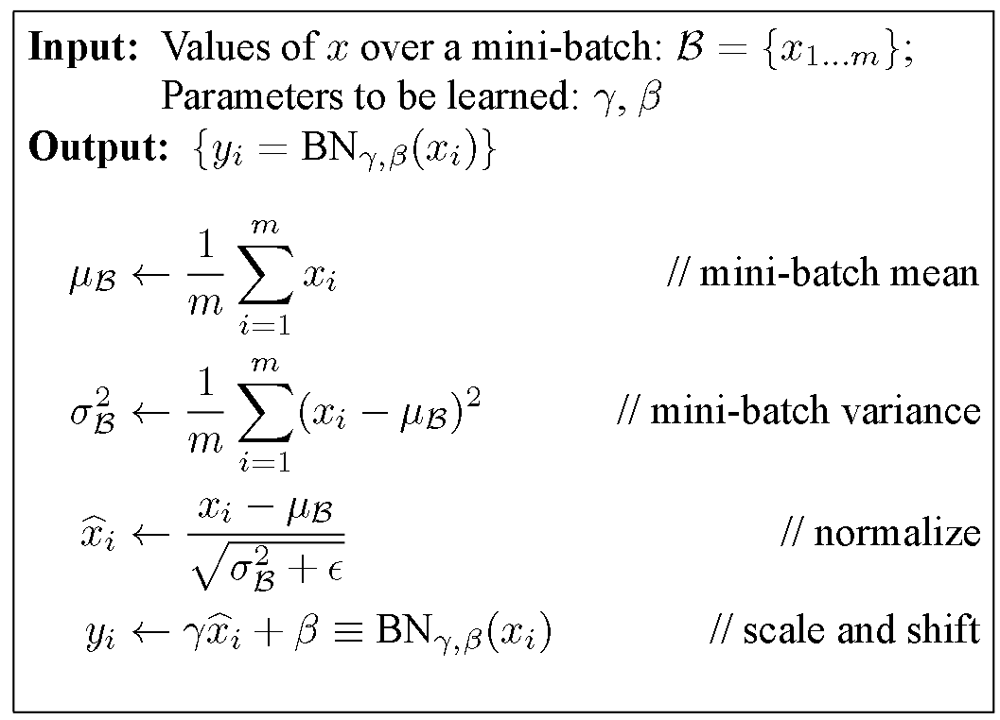
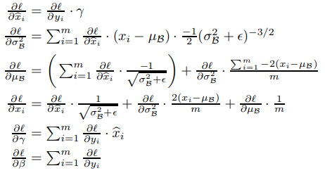
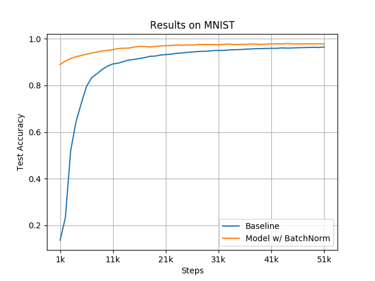

# myModelTestWorking: esperimenti NumPy su MNIST

## Stato del progetto e contenuto

Mini-progetto derivato da una dimostrazione di Batch Normalization. Il codice
attuale e' stato modificato per confrontare rappresentazioni intere 8/16/32 bit:
non coincide piu' con la sola riproduzione BN descritta nella documentazione
originaria, conservata piu' sotto per attribuzione e riferimenti.

- [main.py](main.py): legge MNIST da CSV, costruisce tre reti e avvia training
  sequenziali, mostrando grafici Matplotlib. Le reti attive non includono BN.
- [requirements.txt](requirements.txt): versioni storiche NumPy 1.17.4,
  pandas 0.23.4, Matplotlib 3.1.2 e tqdm 4.40.2.
- [src](src/): codice di rete, layer interi e layer custom floating-point.
- [docs](docs/): figure di forward/backward BN e risultati storici.
- [LICENSE](LICENSE): licenza del mini-progetto; consultarla prima del riuso.

## Come usarlo oggi

Creare un ambiente isolato. `python -m pip install -r requirements.txt` descrive
l'ambiente storico, ma quelle release possono non avere wheel per Python moderno.
Non installarle nell'ambiente principale senza verificarne la compatibilita'.
Non e' presente la directory dati richiesta dal main: procurarsi
`mnist_train.csv` e `mnist_test.csv` con etichetta nella prima colonna e 784 pixel
nelle successive. `pd.read_csv` usa l'intestazione predefinita: controllare che
il formato scelto includa l'header, altrimenti il primo esempio viene perso.

Impostare `mnist_dir` nel main al percorso effettivo; i file IDX di
[data/MNIST](../data/MNIST/) non sono direttamente intercambiabili con questi CSV.
Dalla radice di MSThesis:

```powershell
cd myModelTestWorking
python main.py
```

Il comando non ha argomenti CLI. Learning rate 0.1, batch 60, tre hidden layer
da 100 neuroni e budget 20000 step sono variabili nel sorgente. Il programma
converte gli step in epoche intere. La prima finestra `plt.show()` puo' bloccare
prima dei training a 32 e 16 bit: chiuderla per proseguire. Non c'e' un checkpoint
automatico. Evitare di importare il main come libreria, perche' esegue tutto al
livello modulo.

## Documentazione originaria

La sezione seguente descrive il progetto di partenza. I comandi `cd data` e
`unzip` richiedono dati non inclusi e non sostituiscono la configurazione sopra.

# Batch Normalization

Implementation of the Batch Normalization technique (Numpy) and
reproduction of MNIST results.

Paper:
Ioffe, Sergey, and Christian Szegedy. “Batch Normalization: Accelerating Deep 
Network Training by Reducing Internal Covariate Shift.” ArXiv:1502.03167 [Cs], Mar. 2015. arXiv.org, http://arxiv.org/abs/1502.03167.

MNIST - Dataset:
[LeCun, Y., Bottou, L., Bengio, Y., and Haffner, P. (1998).](http://dx.doi.org/10.1109/5.726791) Gradient-based 
learning applied to document recognition. Proceedings of the IEEE, 86, 2278–2324.

MNIST dataset is made available under the terms of the [Creative Commons 
Attribution-Share Alike 3.0 license](https://creativecommons.org/licenses/by-sa/3.0/).

## Definition

Batch Normalization provides stability to the inputs of the activation functions. 
By doing that, it reduces the number of steps needed to train a model. 

### Forward Pass
<p align="center">
  
  </p>

### Backward Pass
<p align="center">
  
  </p>


## Results
<p align="center">
  
  </p>

## Reproduce

### Requirements

```
pip install -r requirements.txt
```
### Get MNIST

```bash
cd data/
unzip mnist-in-csv.zip
```

### Run Script

```bash
python3 main.py
```

## Possibili bug e limiti rilevati

- **Overflow in preprocessing:** i pixel sono convertiti in `int8` prima dello
  shift; valori 128..255 non sono rappresentabili come positivi. Anche shift,
  prodotti e somme interi non usano una politica esplicita di saturazione.
- **Sigmoide/gradiente incoerenti:** in
  [layers.py](src/feed_forward/layers.py), `SigmoidLayer` restituisce
  `255 / (exp(-x/255) + 1)` ma usa `output * (1-output)` nel backward, formula
  della sigmoide non scalata. La scala e' 255 anche per i modelli 16/32 bit.
- **Loss/gradiente incoerenti:** `CrossEntropyLoss.forward` calcola `-y*log(p)`
  senza normalizzare p; il backward usa `p-y`. Non e' la derivata generale della
  funzione scritta, e valori nulli/non positivi possono produrre inf/NaN.
- **Nomi ingannevoli:** stampa "Model w/ Batch Norm", ma le liste di layer attive
  non contengono `BatchNormLayer`. Il README e le figure originarie non provano
  i risultati delle versioni intere attuali.
- **Quantizzazione:** clipping fino a `2**bits - 1` seguito da cast a interi
  signed supera il massimo positivo rappresentabile; l'aggiornamento non ha
  accumulatori larghi e gestione coerente del segno.
- **Layer custom:** vedere i problemi di convoluzione, BN2d, batch fisso e
  aggregazione delle metriche nel [README dedicato](src/feed_forward/myLayers/README.md).

Questi rilievi derivano dai sorgenti; non sono stati scaricati CSV, eseguiti
training completi o validati numericamente i grafici storici.
